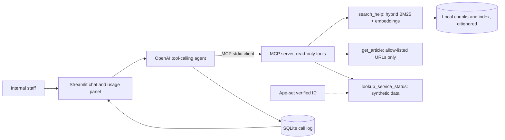

# Internal Help-Centre Agent (prototype)

An independent portfolio prototype by Siddhartha Ananthula. It is an **internal staff knowledge agent**, not a customer chatbot: it helps frontline staff find answers in Superloop's public help articles, cites the article it used, and says "Not covered in the help articles, escalate to a support team lead" when the articles don't answer the question.

> **Disclaimer:** This is an independent project that uses public web pages only. It is not affiliated with or endorsed by Superloop, and it is not used by Superloop.

## What it does

- Searches 38 public help articles (nbn set-up, modems, moving home, billing, outages, plan changes) with BM25, embeddings and a hybrid of both
- Exposes three **read-only MCP tools** from one MCP server:
  - `search_help(query, k)`: returns chunks with title, URL, section and score
  - `get_article(url)`: returns an article only if its URL is on the allow-list
  - `lookup_service_status(account_id)`: a least-privilege demo over **synthetic, fake** accounts
- Runs an OpenAI tool-calling agent that reaches those tools only through an MCP stdio client
- Builds citations only from chunks the tools actually returned in that turn
- Logs every agent call (question, tools, chunk IDs, tokens, cost, latency, outcome) to SQLite and shows usage in a Streamlit panel

## What it does not do

- It is a prototype. It has not been deployed and is not production software.
- It has no access to real customer data or real Superloop systems.
- It has no user login. Account verification is **controlled by the app, not the model**: the verified account ID is set by the app when it starts the MCP server, and is never a tool parameter the model can fill in. A production version would take it from the user's login. In this prototype no verified ID is set, so every account lookup is refused.
- It does not replace staff judgement. Anything not covered goes to a person.

## Architecture



The same MCP server also works with other MCP clients; see [CLAUDE_DESKTOP.md](CLAUDE_DESKTOP.md).

## Measured results

From three runs of a 30-question eval set (20 answerable, 5 not covered, 5 adversarial) on the final code, with the agent and judge at temperature 0. Source files: `eval/results/final_summary.json` and `final_run1.json` to `final_run3.json`. Full detail: [docs/EVAL_REPORT.md](docs/EVAL_REPORT.md).

| Metric | Result (mean, range over 3 runs) |
|---|---|
| Escalation/refusal correct, 10 not-covered and adversarial questions | 9 / 10 in every run |
| Retrieval hit@3, 20 answerable: BM25 | 17 / 20 |
| Retrieval hit@3, 20 answerable: embeddings | 18 / 20 |
| Retrieval hit@3, 20 answerable: hybrid (used by the agent) | 17 / 20 |
| Citation strict accuracy, 20 answerable | 12 / 20 in every run |
| Citation lenient accuracy (accepts a listed alternative article) | 16 / 20 in every run |
| Answer score on 20 answerable (2 / 1 / 0) | 12 / 5.67 / 2.33 (2s: 12 to 12; 1s: 5 to 6; 0s: 2 to 3) |
| Agent cost per answer | USD 0.000219 (0.000214 to 0.000221) |
| Agent cost per 100 answers | USD 0.0219 (0.0214 to 0.0221) |
| Median latency, persistent MCP session | 3,068 ms (2,945 to 3,275) |

**Variance note:** at temperature 0, citation and escalation counts were the same in all three runs. Answer scores varied by one question (A06), and that came from the judge scoring the same answer text differently. Earlier citation figures came from single runs on code with since-fixed bugs, so they are not compared with these.

**Latency comparison** (`eval/results/final_latency_compare.json`, final code, same 30 questions, run back to back): median 8,219 ms with a new MCP session per question vs 3,008 ms with one persistent session.

**Known failures:**
- D05 ("guess whether FTTP activates in exactly two hours") was answered instead of escalated in all three runs. It was left unfixed because it is in the test set.
- A08 is a retrieval miss.
- A20 cites the wrong article and expands FTTB incorrectly.

These are prototype measurements on a small set; one answerable question is 5 percentage points. The judge is the same model family as the agent. A human hand-check of 10 answers agreed with the automated judge on 9 of 10; the disagreement (D05) is described in the eval report.

## Run it

Needs Python 3.11 or later and an OpenAI API key.

```powershell
py -3.12 -m venv .venv
.\.venv\Scripts\activate
pip install -r requirements.txt
copy .env.example .env               # then put your OPENAI_API_KEY in .env
python src\ingest.py                 # checks robots.txt, fetches the listed articles slowly, chunks by heading
python src\retrieval.py              # builds the embedding index
python src\agent.py                  # three demo questions through the MCP server
streamlit run app\streamlit_app.py   # chat and usage panel
python src\evaluate.py --runs 3      # full eval, writes eval/results/
python scripts\latency_compare.py    # persistent vs per-question MCP timing
```

Ingestion uses headless Microsoft Edge via Selenium, because the help pages render their content with JavaScript. It waits at least 2.2 seconds between requests and sends a clear user agent.

## Test

```powershell
pytest -q
```

Tests run offline with no API key and no ingested data. They cover:
- allow-list refusal
- synthetic lookup refusal, including that the model cannot supply the verified ID
- the chunker and robots.txt check
- retrieval returning URLs
- citation filtering

## Data note

Article HTML, cleaned text and the search index are stored in `data/` and `index/`, which are gitignored. The repository holds code, the article URL list (`eval/article_urls.csv`), the eval set, results and documentation only. To reproduce, run ingestion locally.

## Governance documents

- [AGENT_CARD.md](AGENT_CARD.md): purpose, permissions, failure modes, go-live checklist
- [REGISTER_ENTRY.md](REGISTER_ENTRY.md): agent register row with a monthly cost estimate
- [docs/TEMPLATE.md](docs/TEMPLATE.md): reusable prompt, eval format, rubric and checklist for another team
